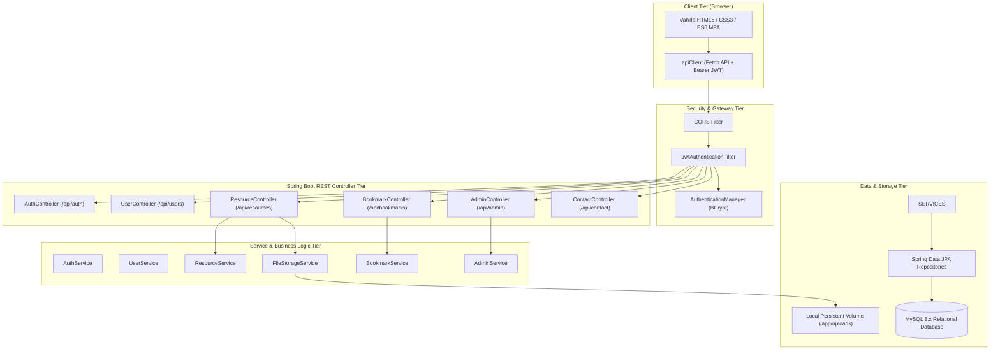
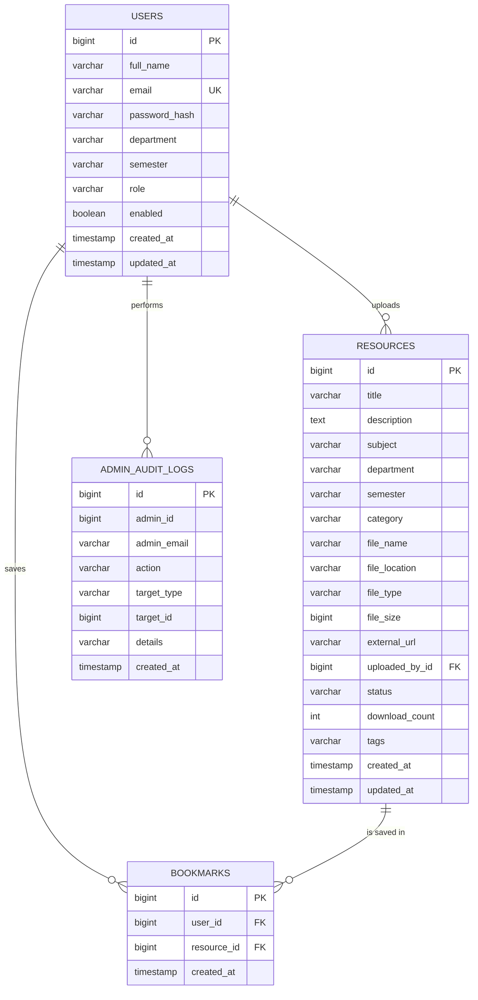

# EduConnect — System Architecture & Design
> **College Learning Resource Sharing Portal — Community Service Project (CSP)**

---

## 1. High-Level Architectural Overview

EduConnect utilizes a decoupled **Multi-Page Application (MPA) + RESTful Backend** architecture. The frontend is built purely with standards-compliant HTML5, CSS3 design tokens, and modular Vanilla ES6 JavaScript, communicating via asynchronous JSON HTTP calls with a **Java 21 / Spring Boot 3.3.4** backend microservice stack backed by a **MySQL 8.x** relational database.

---

## 2. Component Tier Responsibilities

### 1. Presentation Tier (Member 1)
- **Zero Frontend Frameworks:** Implemented without React, Angular, Bootstrap, or Tailwind to satisfy academic constraints and ensure lightweight cross-browser compatibility.
- **Design Tokens:** Strict CSS custom properties for palette (Deep Navy `#1e3a8a`, Academic Blue `#2563eb`, Accent Teal `#0d9488`, Warm Gold `#d97706`), typography, spacing, shadows, and radii.
- **Accessibility:** WCAG 2.2 AA compliant with high-contrast ratios, visible focus outlines, ARIA roles, and screen-reader status indicators.

### 2. Identity, Authentication & Security Tier (Member 2)
- **Stateless Authentication:** Spring Security 6.x `SecurityFilterChain` utilizing signed JWT tokens (HMAC-SHA256).
- **Password Protection:** Passwords are hashed using BCrypt (cost factor 12) before persistence; plaintext credentials never touch logs or responses.
- **Role Separation:** Enforces `ROLE_STUDENT` and `ROLE_ADMIN` permissions via method-level `@PreAuthorize` guards.

### 3. Resource Management & Search Tier (Member 3)
- **Dynamic Multi-Criteria Search:** JPA Criteria queries encapsulated within `ResourceSpecification` combining text keyword, category, department, semester, and file format.
- **File Management:** Physical document storage with sanitized filenames (`UUID_originalName`), path traversal blocking, MIME type validation, and streamed downloads.

### 4. Database, Bookmarking & Admin Tier (Member 4)
- **Relational Integrity:** Foreign keys with `ON DELETE CASCADE` between bookmarks, resources, and users. Composite uniqueness on `(user_id, resource_id)`.
- **Administrative Moderation:** Workflow enforcing `PENDING` status on submissions until approved by an administrator. Comprehensive audit logging via `admin_audit_logs`.

### 5. Integration, QA & Deployment Tier (Member 5)
- **End-to-End Orchestration:** Seamless API configuration via `window.EDUCONNECT_API_BASE_URL`.
- **Test Automation:** 80 automated unit, MockMvc, and end-to-end integration tests with 100% pass rate.
- **Continuous Integration & Delivery:** GitHub Actions workflow and Docker multi-stage containerization.

---

## 3. Relational Database Schema Model

