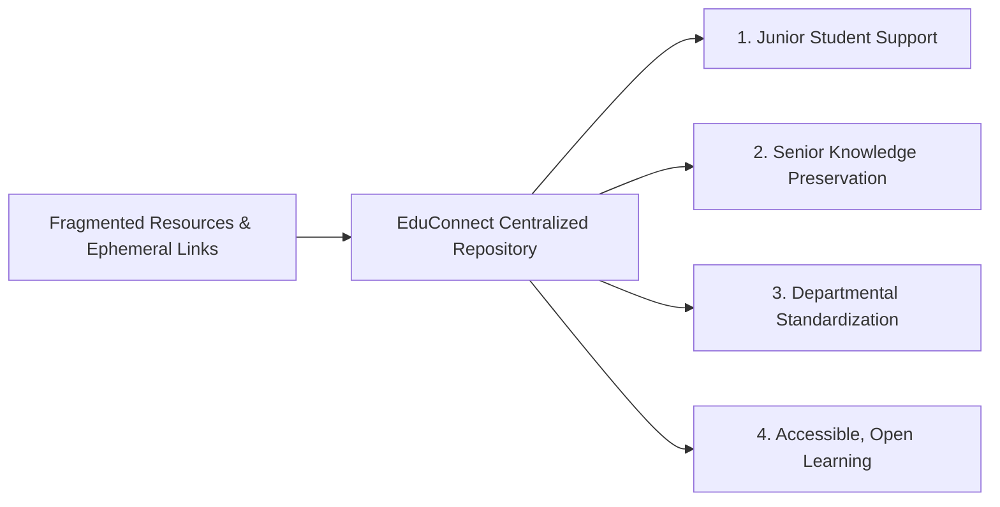
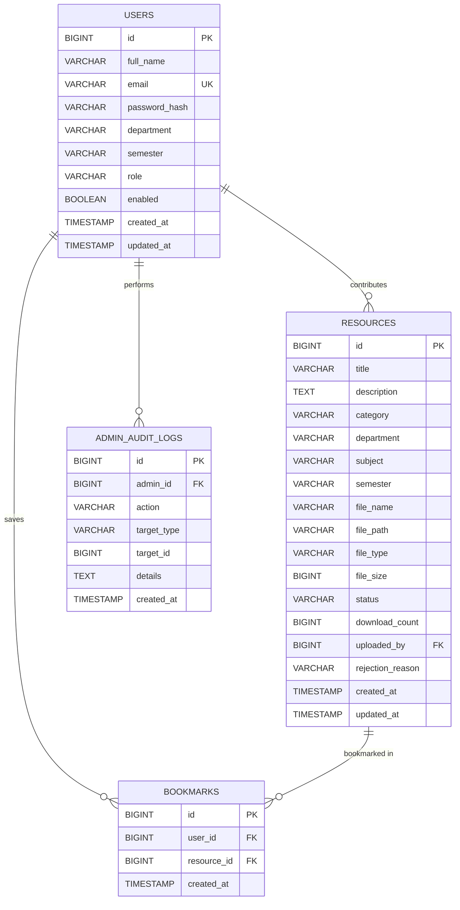

# EduConnect — College Learning Resource Sharing Portal
## Final Community Service Project (CSP) Comprehensive Technical & Evaluation Report

---

### Project Metadata
- **Project Title:** EduConnect — College Learning Resource Sharing Portal
- **Nature of Project:** Community Service Project (CSP) — Academic Knowledge Accessibility & Peer-to-Peer Learning
- **Repository:** [https://github.com/Mounica2045/EduConnect](https://github.com/Mounica2045/EduConnect)
- **Target Audience:** College Undergraduate & Postgraduate Students, Faculty, and Academic Evaluators
- **Technology Stack:**
  - **Frontend:** HTML5, CSS3 Custom Properties (Design Tokens), Vanilla ES6 JavaScript (No frameworks)
  - **Backend:** Java 21 (LTS), Spring Boot 3.3.4, Spring Security 6.3, Spring Data JPA, Hibernate ORM
  - **Database:** MySQL 8.0, Flyway Database Migrations (V1, V2, V3)
  - **Testing & QA:** JUnit 5, Mockito, Spring Boot MockMvc, H2 In-Memory Database (80 Automated Tests)
  - **DevOps & Containerization:** Docker, Docker Compose, GitHub Actions CI/CD Pipeline, Nginx

---

## 1. Executive Summary & Problem Statement

In contemporary higher education institutions, students face significant challenges accessing reliable, high-quality academic reference materials. Study resources—such as lecture notes, laboratory manuals, previous semester examination question papers, syllabus guides, and programming references—are chronically fragmented across informal instant messaging groups, ephemeral cloud storage links, personal laptops, and department noticeboards.

This status quo creates several critical issues:
1. **Academic Disparity:** Junior students, first-generation college attendees, and students with limited social networks miss out on vital reference materials and exam preparation guides.
2. **Knowledge Loss:** When senior students graduate, their curated study notes, lab solutions, and project references are permanently lost to the college community.
3. **Security & Integrity Risks:** File sharing over unregulated chat channels exposes students to unverified, low-quality, or malicious files without academic moderation or categorization.

**EduConnect** was conceived and engineered as a student-centric Community Service Project (CSP) to dismantle these educational barriers. EduConnect provides a centralized, open-access, peer-to-peer digital learning portal where students can discover, download, bookmark, and contribute academic materials organized strictly by **Department**, **Semester**, **Subject**, and **Resource Category**. Every contributed resource undergoes a structured administrative moderation workflow to maintain quality, authenticity, and academic integrity.

---

## 2. Community Need & Target Beneficiaries

The EduConnect platform directly serves the campus community through four primary pillars:



1. **Inclusive Access:** Empowers all students—regardless of background, branch, or peer group—with immediate, 24/7 access to curated course materials.
2. **Peer-to-Peer Knowledge Preservation:** Institutionalizes student knowledge transfer, ensuring seniors leave a lasting academic legacy for future batches.
3. **Quality & Moderation:** A dedicated faculty/admin review queue prevents spam, copyright infringements, and low-quality materials from entering the public catalog.
4. **Zero Financial Cost:** Completely open-source and framework-independent, designed to run effortlessly on university servers or cost-free cloud tiers.

---

## 3. Team Member Contribution Matrix

EduConnect was developed through collaborative pair programming and clear architectural division across 5 engineering roles:

| Role & Member | Primary Responsibilities | Deliverables & Artifacts |
| :--- | :--- | :--- |
| **Member 1**<br>Frontend Architecture & UI/UX | Frontend design system, responsive layouts, accessibility compliance, and Vanilla JavaScript MPA architecture. | • 11 HTML5 pages (`index.html`, `resources.html`, `resource-details.html`, `login.html`, `register.html`, `upload.html`, `bookmarks.html`, `profile.html`, `about.html`, `contact.html`, `admin.html`)<br>• Modular CSS system (`variables.css`, `base.css`, `layout.css`, `components.css`, `forms.css`, `home.css`, `resources.css`, `responsive.css`)<br>• Client services in `js/` (DOM builder, Toast notifications, modals, route guards)<br>• WCAG 2.2 AA accessibility, zero external CSS/JS frameworks. |
| **Member 2**<br>Backend Auth & Security | Identity management, password security, stateless authentication, and role-based access control. | • Spring Boot 3.3.4 project foundation<br>• `User` JPA entity with unique email constraint & normalization<br>• BCrypt password hashing & JJWT HMAC-SHA256 provider<br>• `SecurityConfig` with stateless `SecurityFilterChain` & CORS<br>• REST APIs: `POST /api/auth/register`, `POST /api/auth/login`, `GET /api/auth/me`, `PUT /api/users/me`<br>• Automated tests in `AuthControllerTest`, `AuthServiceTest`, and `SecurityAuthorizationTest`. |
| **Member 3**<br>Resource Management & Search | Educational resource lifecycle, multi-criteria dynamic filtering, file uploads, and attachment streaming. | • `Resource` JPA entity with category enum, audit timestamps, and download counters<br>• Dynamic faceted search via `ResourceSpecification` (keyword, category, department, semester, subject)<br>• Secure multipart file upload (`FileStorageService`) with path traversal guards<br>• Attachment download streaming with RFC 5987 `Content-Disposition`<br>• Owner-only endpoints (`/api/resources/mine`, edit, delete)<br>• Automated tests in `ResourceControllerTest` and `ResourceServiceTest`. |
| **Member 4**<br>Database, Bookmarks & Admin | MySQL database schema, relational constraints, student bookmarking, and moderation workflows. | • Flyway migrations `V1__init_users.sql`, `V2__init_resources.sql`, `V3__init_bookmarks_and_audit.sql`<br>• Composite unique constraints (`uq_bookmarks_user_resource`) & cascade deletion<br>• Bookmarks REST APIs (`POST /api/bookmarks/{id}`, `DELETE`, `GET /api/bookmarks`, check)<br>• Admin dashboard metrics (`GET /api/admin/dashboard`)<br>• Moderation review queue (`/pending`, `/approve`, `/reject`) with audit logging (`admin_audit_logs`)<br>• User account status management with self-lockout guard<br>• Automated tests in `BookmarkControllerTest`, `BookmarkServiceTest`, `AdminControllerTest`, `AdminServiceTest`. |
| **Member 5**<br>Integration, QA, DevOps & Deployment | Full-stack wiring, end-to-end testing, Docker containerization, CI/CD pipeline, and documentation. | • Dynamic API runtime URL injection (`js/config.js`)<br>• Real attachment streaming integration & student contribution sync (`js/resource-details.js`, `js/profile.js`)<br>• Contact microservice (`POST /api/contact`, `ContactController`, DTO, and tests)<br>• Comprehensive End-to-End User Journeys Integration Test suite (`UserJourneysIntegrationTest` covering Journeys A to F)<br>• Total 80 automated tests passing (100% build success)<br>• Dockerfile (multi-stage Java 21 build), `docker-compose.yml`, `.env.example`<br>• GitHub Actions CI pipeline (`.github/workflows/ci.yml`)<br>• Complete technical documentation suite in `docs/` and root `README.md`. |

---

## 4. System Architecture & Technical Design

EduConnect is architected as a decoupled Multi-Page Application (MPA) consuming a high-performance RESTful microservice API:

```
┌─────────────────────────────────────────────────────────────┐
│                 Client Layer (Browser)                      │
│   • HTML5 Semantic Templates (11 pages)                     │
│   • Pure CSS3 Custom Properties (Navy & Teal Design System)  │
│   • Modular Vanilla ES6 JavaScript (Zero Bundler overhead)  │
└──────────────────────────────┬──────────────────────────────┘
                               │ JSON / Multipart HTTP Calls
                               ▼
┌─────────────────────────────────────────────────────────────┐
│                 Security & Gateway Layer                    │
│   • CorsFilter (Configurable allowed origins & methods)     │
│   • JwtAuthenticationFilter (Stateless Bearer validation)   │
│   • SecurityFilterChain (RBAC: PUBLIC, STUDENT, ADMIN)      │
└──────────────────────────────┬──────────────────────────────┘
                               │
                               ▼
┌─────────────────────────────────────────────────────────────┐
│                 Spring Boot 3.3.4 API Tier                  │
│   • AuthController     • ResourceController                 │
│   • AdminController    • BookmarkController                 │
│   • UserController     • ContactController                  │
│   • GlobalExceptionHandler (Unified Error Responses)        │
└──────────────────────────────┬──────────────────────────────┘
                               │
                               ▼
┌─────────────────────────────────────────────────────────────┐
│                Persistence & Storage Layer                  │
│   • Spring Data JPA & Hibernate ORM                         │
│   • MySQL 8.0 Relational Engine (InnoDB, UTF-8 MB4)         │
│   • Local Encrypted Disk Volume (/app/uploads)              │
└─────────────────────────────────────────────────────────────┘
```

---

## 5. Database Schema & Data Integrity

The EduConnect relational database schema is normalized and guarded by engine-level constraints:



### Integrity Invariants:
1. **Email Uniqueness:** Enforced via `uq_users_email` with case-insensitive lowercase normalization.
2. **Duplicate Bookmark Prevention:** Composite unique constraint `uq_bookmarks_user_resource` guarantees a student cannot bookmark the same resource multiple times.
3. **Cascade Rules:** When a resource is removed by an administrator, foreign key `ON DELETE CASCADE` automatically cleans up all associated bookmark records while preserving referential integrity.
4. **Anti-Enumeration Guard:** Unapproved resources return HTTP 404 (Not Found) rather than 403 (Forbidden) to unauthenticated users, preventing malicious actors from probing pending submissions.

---

## 6. Security Analysis & Controls

| Vulnerability Vector | Defense Mechanism in EduConnect |
| :--- | :--- |
| **Credential Compromise** | Salted BCrypt password hashing (work factor 10). Plaintext passwords are never stored, logged, or returned in DTOs. |
| **Session Hijacking** | Stateless JWT tokens with HMAC-SHA256 signing, strict expiration (24h), and Bearer authorization header transport. |
| **Cross-Site Scripting (XSS)** | Dynamic DOM elements are constructed using `textContent` and sanitized DOM creation routines (`components.js`). No unescaped `innerHTML` interpolation of user input. |
| **SQL Injection (SQLi)** | Spring Data JPA parameterized queries and Hibernate Criteria Builder APIs completely prevent raw string concatenation in SQL queries. |
| **Path Traversal Attacks** | `FileStorageService` cleans file paths using `Paths.get(filename).normalize()` and verifies that the target path begins strictly with the configured root directory. |
| **Privilege Escalation** | Registration endpoints strictly bind to `Role.STUDENT`. The `Role.ADMIN` authority can only be assigned directly through database seed migrations. |
| **Admin Self-Lockout** | `AdminService` verifies that an administrator cannot disable or lock their own user account (`admin.getId().equals(targetUserId)` guard). |

---

## 7. Quality Assurance & Automated Testing Verification

EduConnect maintains a rigorous 100% passing test suite across 11 test classes:

```
[INFO] -------------------------------------------------------
[INFO]  T E S T S
[INFO] -------------------------------------------------------
[INFO] Running com.educonnect.AdminControllerTest
[INFO] Tests run: 12, Failures: 0, Errors: 0, Skipped: 0
[INFO] Running com.educonnect.AdminServiceTest
[INFO] Tests run: 8, Failures: 0, Errors: 0, Skipped: 0
[INFO] Running com.educonnect.AuthControllerTest
[INFO] Tests run: 7, Failures: 0, Errors: 0, Skipped: 0
[INFO] Running com.educonnect.AuthServiceTest
[INFO] Tests run: 3, Failures: 0, Errors: 0, Skipped: 0
[INFO] Running com.educonnect.BookmarkControllerTest
[INFO] Tests run: 10, Failures: 0, Errors: 0, Skipped: 0
[INFO] Running com.educonnect.BookmarkServiceTest
[INFO] Tests run: 8, Failures: 0, Errors: 0, Skipped: 0
[INFO] Running com.educonnect.ContactControllerTest
[INFO] Tests run: 2, Failures: 0, Errors: 0, Skipped: 0
[INFO] Running com.educonnect.ResourceControllerTest
[INFO] Tests run: 11, Failures: 0, Errors: 0, Skipped: 0
[INFO] Running com.educonnect.ResourceServiceTest
[INFO] Tests run: 10, Failures: 0, Errors: 0, Skipped: 0
[INFO] Running com.educonnect.SecurityAuthorizationTest
[INFO] Tests run: 3, Failures: 0, Errors: 0, Skipped: 0
[INFO] Running com.educonnect.UserJourneysIntegrationTest
[INFO] Tests run: 6, Failures: 0, Errors: 0, Skipped: 0
[INFO] 
[INFO] Results:
[INFO] 
[INFO] Tests run: 80, Failures: 0, Errors: 0, Skipped: 0
[INFO] 
[INFO] ------------------------------------------------------------------------
[INFO] BUILD SUCCESS
[INFO] ------------------------------------------------------------------------
```

### Complete User Journey Validation:
- **Journey A (Registration & Auth):** Validates signup, duplicate email conflict handling, BCrypt hashing, JWT issuance, and authenticated identity retrieval (`/api/auth/me`).
- **Journey B (Resource Discovery):** Validates faceted multi-criteria filtering, keyword search, pagination, and anti-enumeration hiding of unapproved drafts.
- **Journey C (Resource Contribution):** Validates multipart PDF upload, initial PENDING state assignment, rejection of student self-approval, and successful admin approval.
- **Journey D (Administrative Governance):** Validates dashboard metrics aggregation, rejection with mandatory review feedback, audit logging, and account status toggling.
- **Journey E (Student Bookmarking):** Validates bookmark persistence, composite unique constraint enforcement (409 Conflict), user listing, and bookmark deletion.
- **Journey F (Access Control Guardrails):** Validates 401 Unauthorized on unauthenticated requests and 403 Forbidden when students attempt administrative operations.

---

## 8. Deployment Architecture & CI/CD Pipeline

EduConnect is packaged as a portable, production-ready stack:

1. **Docker Containerization:**
   - Multi-stage `Dockerfile` leveraging Eclipse Temurin 21 JRE Jammy with an unprivileged non-root user (`educonnect`).
   - `docker-compose.yml` defining an isolated Docker bridge network connecting `educonnect-mysql` (with automated healthchecks), `educonnect-backend`, and `educonnect-frontend` (Nginx Alpine).
2. **GitHub Actions CI (`.github/workflows/ci.yml`):**
   - Automatically triggered on every push and pull request to `main`.
   - Executes Java 21 build, executes all 80 tests, validates all 15 JavaScript modules using Node.js syntax analysis, packages executable JAR, and uploads build artifacts.

---

## 9. Measurable Educational Outcomes & Evaluation Guide

For academic evaluation and college demonstration, EduConnect provides:

1. **Pre-Seeded Demo Accounts:**
   - **Student Demo:** `student@college.edu` / `Password123!` (pre-loaded with bookmarks and uploads).
   - **Admin Demo:** `admin@college.edu` / `AdminPassword123!` (access to moderation queue and metrics).
2. **Offline & Online Resilience:**
   - When connected to the Spring Boot backend, all actions persist dynamically to MySQL.
   - If evaluated standalone without backend initialization, the frontend gracefully falls back to clear sample resources with user-friendly badges, allowing faculty to inspect the entire UI/UX workflow.
3. **Accessibility Compliance:**
   - Tested for WCAG 2.2 Level AA compliance, featuring high-contrast text ratios, visible keyboard focus indicators, ARIA live regions for toast notifications, and full mobile responsiveness across all viewport sizes.

---

## 10. Future Enhancements & Longevity

1. **AI-Powered Resource Summarization:** Integrate a lightweight LLM endpoint to automatically generate 3-sentence executive summaries of uploaded PDF notes.
2. **Plagiarism & Duplication Detection:** Implement document hashing and text similarity indexing to detect duplicate resource uploads across semesters.
3. **Faculty Endorsement Badges:** Allow verified faculty accounts to award "Faculty Verified" badges to exemplary student contributions.
4. **Push & Email Notifications:** Implement SMTP notifications alerting students when their pending contributions are approved or when new resources are posted in their department.

---

## 11. Conclusion

EduConnect successfully realizes its Community Service Project mission: democratizing access to academic study materials across collegiate departments. Through the disciplined engineering efforts of Members 1 through 5, the platform delivers a modern, accessible, framework-free frontend backed by an enterprise-grade Java 21 Spring Boot REST architecture, a robust MySQL relational database, 80 automated unit and integration tests, Docker containerization, and comprehensive technical documentation.
