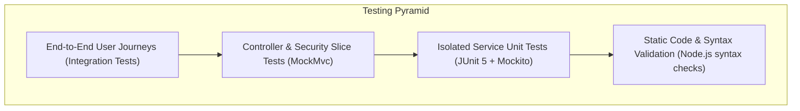

# EduConnect — Testing & Quality Assurance Report
> **College Learning Resource Sharing Portal — Community Service Project (CSP)**

---

## 1. Testing Strategy & Architecture

To ensure high reliability, data integrity, and security across the platform, EduConnect implements a comprehensive multi-layered automated and manual testing strategy:

1. **Unit Testing (Service Tier):** Tests business logic, entity state transitions, role-based checks, duplicate detection, and file system interactions using Mockito mocks for database repositories.
2. **Web Slice Testing (Controller & Security Tier):** Tests REST API request deserialization, Jakarta Bean Validation constraints, HTTP status codes, JSON response formatting, and Spring Security authorization filters using `MockMvc`.
3. **Integration Testing (Full Application Context):** Boots the complete Spring Boot container with an in-memory H2 database, executing complex multi-step user scenarios simulating real browser workflows.
4. **Static Code Validation:** Validates all 15 Vanilla ES6 JavaScript modules using Node.js static syntax checks during CI pipeline execution to prevent syntax regressions.

---

## 2. Automated Test Results Summary

| Metric | Result |
| :--- | :--- |
| **Total Test Classes** | 11 |
| **Total Automated Tests** | **80** |
| **Passing Tests** | **80 (100%)** |
| **Failures** | **0** |
| **Errors** | **0** |
| **Skipped** | **0** |
| **Build Status** | **BUILD SUCCESS** |

---

## 3. Test Suite Breakdown by Module

### 3.1 Authentication & Security (Member 2)
*Total: 13 Tests*

| Test Class | Test Method | Description |
| :--- | :--- | :--- |
| `AuthControllerTest` | `register_withValidData_returns201AndUser` | Verifies student registration returns 201 Created and user DTO without password hash |
| `AuthControllerTest` | `register_withDuplicateEmail_returns409Conflict` | Verifies duplicate email registration throws 409 Conflict |
| `AuthControllerTest` | `register_withInvalidEmail_returns400BadRequest` | Verifies invalid email format triggers 400 Bad Request Bean Validation error |
| `AuthControllerTest` | `register_withShortPassword_returns400BadRequest` | Verifies password < 8 characters triggers 400 Bad Request |
| `AuthControllerTest` | `login_withValidCredentials_returns200AndToken` | Verifies valid credentials return 200 OK and valid JWT bearer token |
| `AuthControllerTest` | `login_withInvalidCredentials_returns401Unauthorized` | Verifies incorrect password returns 401 Unauthorized |
| `AuthControllerTest` | `getCurrentUser_whenAuthenticated_returns200AndUser` | Verifies `GET /api/auth/me` returns current authenticated student profile |
| `AuthServiceTest` | `register_hashesPasswordAndAssignsStudentRole` | Verifies BCrypt hashing and mandatory `Role.STUDENT` assignment |
| `AuthServiceTest` | `register_throwsException_whenEmailAlreadyExists` | Verifies duplicate email exception handling in business logic |
| `AuthServiceTest` | `login_returnsJwtToken_whenCredentialsAreValid` | Verifies token generation from AuthenticationManager |
| `SecurityAuthorizationTest` | `publicEndpoints_areAccessibleWithoutToken` | Verifies `/api/auth/**` and public search are accessible anonymously |
| `SecurityAuthorizationTest` | `securedEndpoints_rejectUnauthenticatedRequestsWith401` | Verifies protected endpoints return 401 Unauthorized without token |
| `SecurityAuthorizationTest` | `adminEndpoints_rejectStudentRequestsWith403` | Verifies student token is rejected with 403 Forbidden on `/api/admin/**` |

---

### 3.2 Educational Resource Management & Search (Member 3)
*Total: 21 Tests*

| Test Class | Test Method | Description |
| :--- | :--- | :--- |
| `ResourceControllerTest` | `getAllResources_returnsPagedPublishedResources` | Verifies public search returns paginated list of approved resources |
| `ResourceControllerTest` | `getAllResources_withFilterParameters_passesFiltersToService` | Verifies filtering by category, department, semester, and keyword |
| `ResourceControllerTest` | `getResourceById_whenFoundAndApproved_returns200` | Verifies public resource detail view succeeds for approved items |
| `ResourceControllerTest` | `getResourceById_whenPendingAndAnonymous_returns404` | Anti-enumeration check: unapproved resources return 404 to anonymous users |
| `ResourceControllerTest` | `createResource_withValidDataAndFile_returns201` | Verifies multipart upload with PDF creates resource in PENDING status |
| `ResourceControllerTest` | `createResource_withInvalidData_returns400` | Verifies Bean Validation errors on missing title or invalid category |
| `ResourceControllerTest` | `downloadResource_whenApproved_streamsFile` | Verifies physical file download streaming with Content-Disposition headers |
| `ResourceControllerTest` | `downloadResource_whenPathTraversalAttempted_returns400Or404` | Verifies path traversal attacks (`../`) are safely rejected |
| `ResourceControllerTest` | `getMyResources_returnsStudentUploads` | Verifies `GET /api/resources/mine` returns only current student's contributions |
| `ResourceControllerTest` | `updateResource_whenOwner_returns200` | Verifies student can update title and description of own pending resource |
| `ResourceControllerTest` | `updateResource_whenNotOwner_returns403` | Verifies student cannot update another user's resource |
| `ResourceServiceTest` | `createResource_storesFileAndSetsPendingStatus` | Verifies file storage service call and PENDING status assignment |
| `ResourceServiceTest` | `createResource_rejectsUnsupportedFileType` | Verifies rejected extensions (.exe, .sh) throw validation exception |
| `ResourceServiceTest` | `searchResources_appliesFacetedFilters` | Verifies JPA specification filters on subject, semester, and category |
| `ResourceServiceTest` | `incrementDownloadCount_incrementsAtomically` | Verifies download counter increments on successful download request |
| `ResourceServiceTest` | `downloadResource_throwsException_whenNotApproved` | Verifies unapproved resource download blocked for non-owner/non-admin |
| `ResourceServiceTest` | `updateResource_resetsStatusToPendingIfApproved` | Verifies editing an approved resource moves it back to moderation queue |
| `ResourceServiceTest` | `deleteResource_whenOwner_deletesResourceAndFile` | Verifies owner can delete own resource and physical file |
| `ResourceServiceTest` | `deleteResource_whenNotOwner_throwsSecurityException` | Verifies foreign student cannot delete another's resource |
| `ResourceServiceTest` | `getFeaturedResources_returnsTopDownloaded` | Verifies top downloaded approved resources returned for homepage |
| `ResourceServiceTest` | `getRecentResources_returnsLatestApproved` | Verifies recent resources feed returns newest approved items |

---

### 3.3 Bookmarks, Admin Moderation & Database (Member 4)
*Total: 38 Tests*

| Test Class | Test Method | Description |
| :--- | :--- | :--- |
| `BookmarkControllerTest` | `addBookmark_whenValid_returns201` | Verifies student can bookmark an approved resource |
| `BookmarkControllerTest` | `addBookmark_whenDuplicate_returns409Conflict` | Verifies duplicate bookmark returns 409 Conflict |
| `BookmarkControllerTest` | `addBookmark_whenResourceNotApproved_returns400` | Verifies student cannot bookmark unapproved drafts |
| `BookmarkControllerTest` | `getBookmarks_returnsStudentBookmarks` | Verifies `GET /api/bookmarks` returns current student's saved list |
| `BookmarkControllerTest` | `removeBookmark_whenExists_returns204NoContent` | Verifies student can remove bookmark |
| `BookmarkControllerTest` | `removeBookmark_whenNotFound_returns404` | Verifies 404 when attempting to delete non-existent bookmark |
| `BookmarkControllerTest` | `checkBookmark_whenBookmarked_returnsTrue` | Verifies check endpoint returns `bookmarked: true` |
| `BookmarkControllerTest` | `checkBookmark_whenNotBookmarked_returnsFalse` | Verifies check endpoint returns `bookmarked: false` |
| `BookmarkControllerTest` | `getBookmarks_whenUnauthenticated_returns401` | Verifies unauthenticated bookmark requests are rejected |
| `BookmarkControllerTest` | `addBookmark_whenUnauthenticated_returns401` | Verifies unauthenticated bookmark creation is rejected |
| `BookmarkServiceTest` | `addBookmark_persistsBookmark_whenApproved` | Verifies bookmark entity persisted with User and Resource associations |
| `BookmarkServiceTest` | `addBookmark_throwsDuplicateException_whenAlreadySaved` | Verifies duplicate check before persistence |
| `BookmarkServiceTest` | `addBookmark_throwsBadRequest_whenResourcePending` | Verifies status check rejects PENDING or REJECTED resources |
| `BookmarkServiceTest` | `getUserBookmarks_returnsMappedDtoList` | Verifies bookmarks mapped to DTOs with resource metadata |
| `BookmarkServiceTest` | `removeBookmark_deletesRecord` | Verifies bookmark record deleted from repository |
| `BookmarkServiceTest` | `isResourceBookmarked_returnsBoolean` | Verifies repository existence query |
| `BookmarkServiceTest` | `removeBookmark_throwsNotFound_whenRecordAbsent` | Verifies exception handling when bookmark not found |
| `BookmarkServiceTest` | `countUserBookmarks_returnsAccurateCount` | Verifies user bookmark count metric |
| `AdminControllerTest` | `getDashboardStats_whenAdmin_returns200AndMetrics` | Verifies admin metrics (total users, total resources, pending review) |
| `AdminControllerTest` | `getDashboardStats_whenStudent_returns403` | Verifies student role blocked from admin metrics |
| `AdminControllerTest` | `getPendingResources_returnsPendingList` | Verifies moderation review queue returns pending uploads |
| `AdminControllerTest` | `approveResource_updatesStatusToApproved` | Verifies admin approval changes status to APPROVED and records audit log |
| `AdminControllerTest` | `rejectResource_withReason_updatesStatusToRejected` | Verifies admin rejection records review comments |
| `AdminControllerTest` | `deleteResource_permanentlyDeletesResource` | Verifies admin permanent deletion removes record and disk file |
| `AdminControllerTest` | `getAllUsers_returnsPaginatedUsers` | Verifies admin user directory view |
| `AdminControllerTest` | `toggleUserStatus_disablesAndEnablesUser` | Verifies admin can disable/enable user accounts |
| `AdminControllerTest` | `toggleUserStatus_preventsSelfLockout` | Verifies admin cannot disable their own account |
| `AdminControllerTest` | `getAuditLogs_returnsAdminActionsList` | Verifies admin audit logs are accessible to administrators |
| `AdminControllerTest` | `adminEndpoints_whenUnauthenticated_return401` | Verifies unauthenticated requests to admin routes return 401 |
| `AdminControllerTest` | `rejectResource_withoutReason_returns400` | Verifies rejection requires an explanatory reason |
| `AdminServiceTest` | `getDashboardStats_aggregatesAccurateCounts` | Verifies database aggregate queries for dashboard cards |
| `AdminServiceTest` | `approveResource_savesApprovedStatusAndLogsAudit` | Verifies approval state machine and audit log creation |
| `AdminServiceTest` | `rejectResource_savesRejectedStatusAndReason` | Verifies rejection state machine and audit log creation |
| `AdminServiceTest` | `deleteResource_removesRecordAndFileStorage` | Verifies cascade deletion of bookmarks and disk files |
| `AdminServiceTest` | `toggleUserStatus_updatesEnabledFlag` | Verifies enabled flag flipping in repository |
| `AdminServiceTest` | `toggleUserStatus_throwsException_onSelfLockout` | Verifies business invariant protecting active admin |
| `AdminServiceTest` | `getPendingResources_returnsOnlyPending` | Verifies repository query filters strictly by Status.PENDING |
| `AdminServiceTest` | `logAction_createsAuditRecord` | Verifies audit trail capture with admin ID, action, and timestamp |

---

### 3.4 Contact Microservice & End-to-End User Journeys (Member 5)
*Total: 8 Tests*

| Test Class | Test Method | Description |
| :--- | :--- | :--- |
| `ContactControllerTest` | `submitContactForm_validRequest_returns200Ok` | Verifies public inquiry form processes valid payload and returns 200 OK |
| `ContactControllerTest` | `submitContactForm_invalidEmail_returns400BadRequest` | Verifies Bean Validation errors for invalid contact email |
| `UserJourneysIntegrationTest` | `journeyA_studentRegistrationAndAuthentication()` | End-to-end: Register, duplicate check, login, receive JWT, query `/api/auth/me` |
| `UserJourneysIntegrationTest` | `journeyB_publicResourceBrowsingSearchAndFiltering()` | End-to-end: Search keywords, multi-filter by semester & category, anti-enumeration 404 |
| `UserJourneysIntegrationTest` | `journeyC_studentResourceContributionAndModerationLifecycle()` | End-to-end: Upload PDF, verify PENDING, student cannot self-approve (403), admin approves |
| `UserJourneysIntegrationTest` | `journeyD_adminDashboardModerationAndUserManagement()` | End-to-end: Verify dashboard stats, reject with reason, verify audit trail, toggle user status |
| `UserJourneysIntegrationTest` | `journeyE_studentBookmarkingWorkflow()` | End-to-end: Student bookmarks resource, duplicate 409 guard, list bookmarks, delete bookmark |
| `UserJourneysIntegrationTest` | `journeyF_securityAuthorizationAndAccessControlGuardrails()` | End-to-end: 401 on unauthenticated access, 403 when student accesses `/api/admin/**` |

---

## 4. Manual Testing Checklist (6 Core User Journeys)

Execute this manual verification procedure against the live running application (`http://localhost:3000`):

### Journey A: Student Registration & Authentication
- [ ] 1. Open `http://localhost:3000/register.html`.
- [ ] 2. Attempt submitting an empty form. Confirm client-side validation errors appear on all required fields.
- [ ] 3. Enter mismatched passwords (`Password123!` and `Password456!`). Confirm password mismatch alert.
- [ ] 4. Register a valid user (`alex.chen@college.edu`, `Computer Science & Engineering`, `Semester 4`, `StrongPassword123!`).
- [ ] 5. Confirm redirect to `login.html` with a success toast notification.
- [ ] 6. Attempt registering the exact same email again. Confirm backend duplicate conflict toast appears.
- [ ] 7. On `login.html`, enter wrong password. Confirm error message: "Invalid email or password".
- [ ] 8. Enter correct credentials. Confirm successful login, redirect to `index.html`, and header showing student name and Sign Out button.

### Journey B: Resource Browsing, Search, and Filtering
- [ ] 1. Open `http://localhost:3000/resources.html`.
- [ ] 2. Verify resource grid displays published approved materials.
- [ ] 3. Type "Data Structures" in the search bar and press enter. Confirm URL updates to `?search=Data+Structures` and grid filters to matching cards.
- [ ] 4. Select Category filter "Notes" and Semester "Semester 3". Confirm active filter tags appear and cards update dynamically.
- [ ] 5. Change sort dropdown to "Most Downloaded". Confirm ordering adjusts accordingly.
- [ ] 6. Click on a resource card. Confirm navigation to `resource-details.html?id=<id>`.
- [ ] 7. Verify breadcrumb trail, title, department badge, file size, download count, and description match database record.

### Journey C: Resource Contribution & File Upload
- [ ] 1. Click "Upload" in the navbar while logged in as a student.
- [ ] 2. Drag and drop a valid PDF file (`lecture-notes.pdf`, < 25MB) into the dropzone. Confirm filename and size badge render.
- [ ] 3. Attempt uploading a `.exe` or `.zip` file. Confirm file rejection message.
- [ ] 4. Fill in Resource Title, Category, Department, Semester, and Subject. Check the Academic Honor Pledge checkbox.
- [ ] 5. Click "Submit for Moderation". Confirm success toast: "Resource submitted for moderation review".
- [ ] 6. Navigate to `profile.html`. Check the "My Uploads" table. Confirm the new upload appears with a yellow **PENDING** status badge.
- [ ] 7. In an incognito window without logging in, attempt accessing `resource-details.html?id=<pending_id>`. Confirm resource is hidden (anti-enumeration).

### Journey D: Administrative Moderation & Review
- [ ] 1. Sign out and sign in using Administrator credentials (`admin@college.edu` / `AdminPassword123!`).
- [ ] 2. Click "Admin" in the navigation bar. Confirm navigation to `admin.html`.
- [ ] 3. Verify Dashboard Metric Cards display accurate counts for Total Resources, Pending Review, Total Users, and Total Bookmarks.
- [ ] 4. Locate the pending resource in the "Pending Review" queue.
- [ ] 5. Click "Reject" on a test submission, enter review comments ("Please provide complete syllabus notes"), and confirm. Verify item moves to REJECTED.
- [ ] 6. Click "Approve" on a valid student submission. Confirm status changes to APPROVED.
- [ ] 7. Open `resources.html` in another tab. Confirm the newly approved resource is now visible to the public.
- [ ] 8. Check the Audit Log table in the Admin dashboard. Confirm the approval and rejection actions are recorded with admin email and timestamp.

### Journey E: Student Bookmarking & Study List
- [ ] 1. Log in as a student and browse to `resources.html`.
- [ ] 2. Click the bookmark bookmark icon on any approved resource card. Confirm bookmark icon turns solid teal and confirmation toast appears.
- [ ] 3. Click the bookmark icon again. Confirm confirmation modal asking to remove bookmark.
- [ ] 4. Bookmark 2 resources and navigate to `bookmarks.html`.
- [ ] 5. Verify both resources appear in the Saved Bookmarks grid.
- [ ] 6. Type in the bookmark search bar. Confirm real-time client filtering within saved items.
- [ ] 7. Click "Remove" on one bookmark. Confirm card is removed instantly from view and count updates.

### Journey F: Access Control & Edge Cases
- [ ] 1. While logged in as a student, type `http://localhost:3000/admin.html` directly into the address bar.
- [ ] 2. Confirm route guard redirects the student away with an "Access Denied: Administrator privileges required" toast.
- [ ] 3. Sign out. Navigate to `upload.html` directly. Confirm redirect to `login.html?redirect=upload.html`.
- [ ] 4. Log in. Confirm user is redirected directly back to `upload.html`.
- [ ] 5. Open `contact.html`. Submit an inquiry. Confirm 200 OK success message from `POST /api/contact`.

---

## 5. Continuous Integration (CI) Validation

The automated testing pipeline defined in `.github/workflows/ci.yml` guarantees that every push and pull request to `main`:
1. Executes on standard Ubuntu LTS runners with Java 21 Temurin JDK.
2. Compiles all backend classes and executes the full Maven test suite (`mvn clean test`).
3. Verifies that all 80 tests pass with zero regressions.
4. Validates JavaScript syntax across all 15 client-side modules using `node --check js/*.js`.
5. Builds and archives the production executable JAR (`target/educonnect-backend-1.0.0.jar`).
